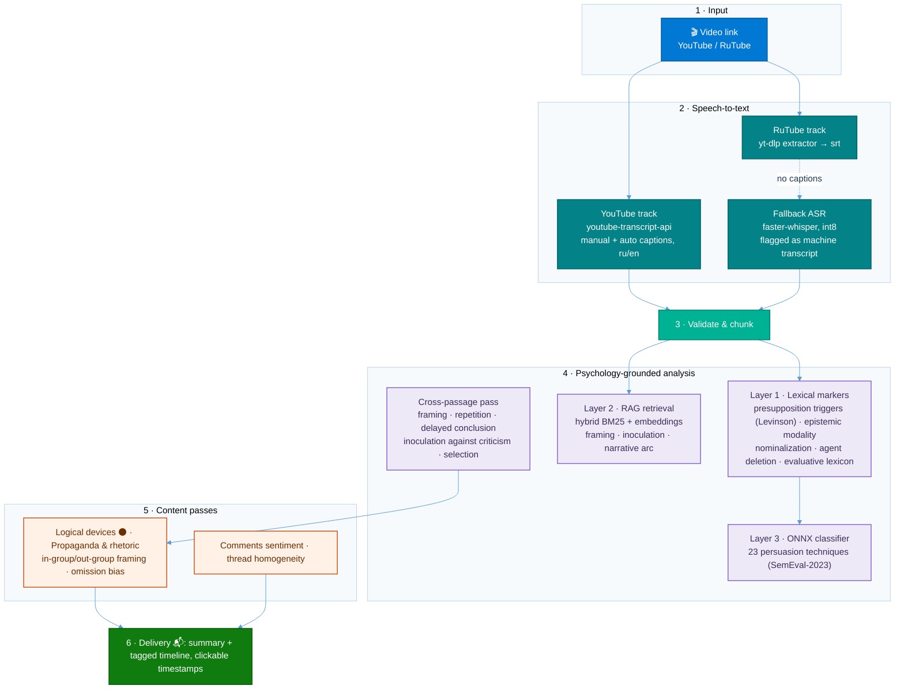

# Psychology analysis skill (installable on a clean Hermes)

**Нейросетевой классификатор дообучен на классическом корпусе по пропаганде и манипуляциям** — база знаний построена на текстах:

1. *Спирица Е., Пелехатый М. — «Боевое НЛП» (2020)*
2. *Непряхин Н. — «Я манипулирую тобой» (2018)*
3. *Бернейс Э. — «Пропаганда» (2021)*
4. *Эллюль Ж. — «Феномен пропаганды» (2023)*
5. *Эко У. — «Полный назад!» (2012)*
6. *Кара-Мурза С. — «Манипуляция сознанием»*
7. *Арендт Х. — «Истоки тоталитаризма» (1996)*

Marks manipulation devices in text/messages with the standing tag system, using three
layers that do not depend on the text containing the name of a device. The corpus covers
applied-psychology territory: manipulation and influence tactics, cognitive biases,
propaganda techniques and logical fallacies, in both Russian and English text. A dedicated
part of the corpus is propaganda analysis — how persuasion campaigns and totalitarian
regimes manufacture consent, and how to recognize and counter it.

## How the bot analyzes video content (YouTube / RuTube)

The same psychology-grounded stack powers the Telegram bot's video analysis: a transcript
(YouTube/RuTube caption tracks, or local `faster-whisper` ASR as fallback) runs through the
marker → RAG → classifier pipeline, a cross-passage pass for devices that only exist across
paragraphs, content passes (logical devices, propaganda and rhetoric, financial
misinformation), and a lexicon-based comment-sentiment stage. The result is a summary plus a
single sorted timeline with clickable timestamps.




The colorful version above is exactly what GitHub renders; a high-resolution PNG export
lives alongside the source in [`assets/`](assets/video-analysis-pipeline.mmd).

1. **Marker layer** — `scripts/markers.py` + `psychology/markers.json`: deterministic, no LLM,
   ~1 ms. Finds what is physically visible in the text (presupposition triggers per Levinson,
   modality and epistemic distance, nominalization and agent deletion, evaluative lexicon,
   structural markers, repetition).
2. **RAG** — `scripts/rag_mcp.py` / `scripts/rag_query.py`: definitions of the devices from the
   closed list (`psychology/devices.json`) plus book chunks when the book is present.
3. **Classifier** — `scripts/classifier.py`: fine-tuned encoder, second opinion by annotated
   data. Model: `Mishtar4/persuasion-detector-xlm-roberta` (XLM-RoBERTa-large, 23 SemEval-2023
   Task 3 labels, Russian input directly — no translation). Runs as ONNX int8 through
   onnxruntime; torch is needed only at conversion time.

The classifier never overrides the closed list or the markers: on disagreement both are shown.

## Install on a clean Hermes

```bash
git clone https://github.com/AlexShutov/BigBroAnalyzeHermesSkill ~/.hermes/skills/bigbro-analyze
bash ~/.hermes/skills/bigbro-analyze/scripts/setup.sh
```

Requirements: CPython 3.11–3.14 (onnxruntime has no wheels for newer versions; setup.sh picks a
supported interpreter), network access for the model download (~1.1 GB weights, ~550 MB after
conversion), Google Chrome not needed, Telegram token only if the plugin path is used.
`onnx` is needed at conversion time only; the runtime uses onnxruntime.
The book is not in the repo (copyright); without it the index is built from `devices.json` only.

### Books in the corpus (knowledge base)

`rag_build.py` ingests every book it finds locally: `psychology/*.fb2` (chunked by FB2
paragraphs with section titles), `psychology/books/*.jsonl` and `psychology/*.pdf` via
`scripts/book_ingest.py` (PDF / EPUB / .doc / .txt). The current corpus:

1. *Спирица Е., Пелехатый М. — «Боевое НЛП» (2020)* — FB2
2. *Непряхин Н. — «Я манипулирую тобой» (2018)* — PDF
3. *Бернейс Э. — «Пропаганда» (2021)* — EPUB
4. *Эллюль Ж. — «Феномен пропаганды» (2023)* — FB2
5. *Эко У. — «Полный назад!» (2012)* — FB2
6. *Кара-Мурза С. — «Манипуляция сознанием»* — DOC
7. *Арендт Х. — «Истоки тоталитаризма» (1996)* — PDF (OCR-слой)

A book is added by

```bash
python3 scripts/book_ingest.py "<book>.pdf|.epub|.doc|.txt" --source "Автор «Название»"
python3 scripts/rag_build.py   # rebuild the index over all books
```

Merging, not appending: at build time a chunk whose embedding is ≥ 0.90 cosine to an
already-kept document is dropped as a duplicate, so only non-overlapping material from
the new book enters the index. Retrieval also reserves slots for the two best-scoring
device definitions, so prose from a large corpus cannot crowd them out of top-k.

## Model version and updates

`psychology/models/model_version.json` stores the model id, the revision the ONNX was built from
and the format. On the first use in a session `scripts/model_update_check.py` compares the stored
version with the hub and looks for similar models that cover Russian with a better reported metric.
If an update is warranted it marks the state as needed (`psychology/models/update_state.json`) and
starts the download in the background (`scripts/model_update_run.py`), then verifies the new model
against the one in use on three control texts.

The model in use keeps serving until the new one is verified and explicitly promoted with
`scripts/model_promote.py`. When an update is started, the analysis must say it out loud:
update started, old model still in use.

## Measured

Marker layer ~1 ms. Classifier: session load 0.5 s, 19 ms per paragraph warm (tokenizer must be
cached), peak RSS ~1.3 GB, gated by the marker layer — no marker hits, no model load.
Per message: manipulative text ~2.3 s, neutral text ~1.1 s.

Quality note: paragraph-level detection is strong (published micro-F1 ~0.92), fine-grained
per-technique classification is weak (~0.26–0.45) — hence "second opinion", not a verdict.

## Files

```
SKILL.md
README.md
psychology/devices.json          closed device list
psychology/markers.json          surface markers per device family
psychology/taxonomy_map.json     SemEval labels -> our devices
psychology/models/               ONNX int8 + tokenizer + labels + thresholds + model_version.json
psychology/books/                extracted book paragraphs (JSONL, git-ignored)
references/manipulation-devices.md
references/classifier-layer.md
scripts/markers.py classifier.py rag_core.py rag_build.py rag_query.py rag_mcp.py
scripts/book_ingest_pdf.py
scripts/model_setup.py model_update_check.py model_update_run.py model_promote.py setup.sh
plugin/psych-rag/                pre_gateway_dispatch hook (no core patch)
```
