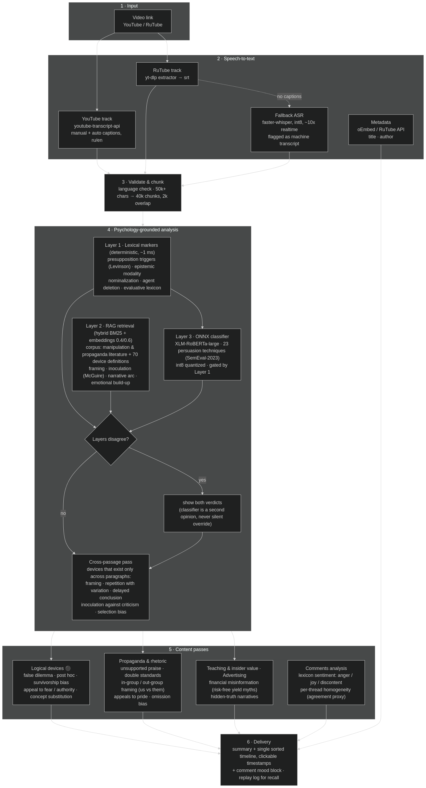
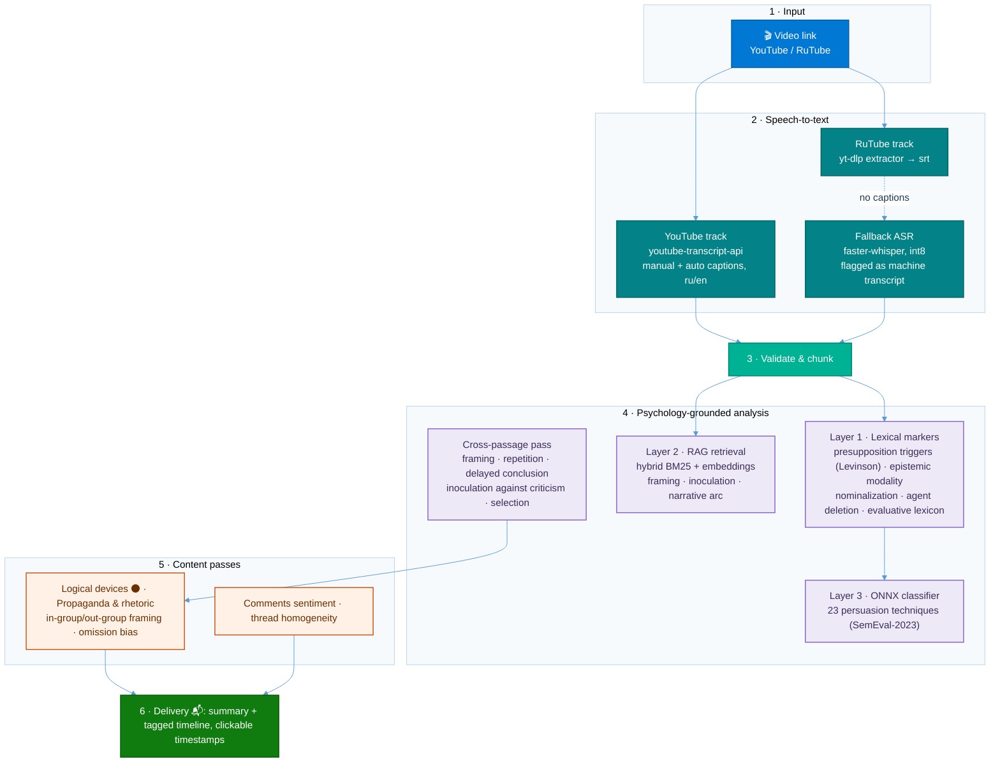

# Psychology analysis skill (installable on a clean Hermes)
   

**Нейросетевой классификатор дообучен на классическом корпусе по пропаганде и манипуляциям** — база знаний построена на текстах:

1. *Спирица Е., Пелехатый М. — «Боевое НЛП» (2020)*
2. *Непряхин Н. — «Я манипулирую тобой» (2018)*
3. *Бернейс Э. — «Пропаганда» (2021)*
4. *Эллюль Ж. — «Феномен пропаганды» (2023)*
5. *Эко У. — «Полный назад!» (2012)*
6. *Кара-Мурза С. — «Манипуляция сознанием»*
7. *Арендт Х. — «Истоки тоталитаризма» (1996)*

Marks manipulation devices in text/messages with the standing tag system, using three
layers that do not depend on the text containing the name of a device. The corpus covers
applied-psychology territory: manipulation and influence tactics, cognitive biases,
propaganda techniques and logical fallacies, in both Russian and English text. A dedicated
part of the corpus is propaganda analysis — how persuasion campaigns and totalitarian
regimes manufacture consent, and how to recognize and counter it.

## How the bot analyzes video content (YouTube / RuTube)

The same psychology-grounded stack powers the Telegram bot's video analysis: a transcript
(YouTube/RuTube caption tracks, or local `faster-whisper` ASR as fallback) runs through the
marker → RAG → classifier pipeline, a cross-passage pass for devices that only exist across
paragraphs, content passes (logical devices, propaganda and rhetoric, financial
misinformation), and a lexicon-based comment-sentiment stage. The result is a summary plus a
single sorted timeline with clickable timestamps.





The colorful version above is exactly what GitHub renders; a high-resolution PNG export
lives alongside the source in [`assets/`](assets/video-analysis-pipeline.mmd).

1. **Marker layer** — `scripts/markers.py` + `psychology/markers.json`: deterministic, no LLM,
   ~1 ms. Finds what is physically visible in the text (presupposition triggers per Levinson,
   modality and epistemic distance, nominalization and agent deletion, evaluative lexicon,
   structural markers, repetition).
2. **RAG** — `scripts/rag_mcp.py` / `scripts/rag_query.py`: definitions of the devices from the
   closed list (`psychology/devices.json`) plus book chunks when the book is present.
3. **Classifier** — `scripts/classifier.py`: fine-tuned encoder, second opinion by annotated
   data. Model: `Mishtar4/persuasion-detector-xlm-roberta` (XLM-RoBERTa-large, 23 SemEval-2023
   Task 3 labels, Russian input directly — no translation). Runs as ONNX int8 through
   onnxruntime; torch is needed only at conversion time.

The classifier never overrides the closed list or the markers: on disagreement both are shown.

## Install on a clean Hermes

```bash
git clone https://github.com/AlexShutov/BrainHackAnalyzeHermesSkill ~/.hermes/skills/brain-hack-analyze
bash ~/.hermes/skills/brain-hack-analyze/scripts/setup.sh
```

Requirements: CPython 3.11–3.14 (onnxruntime has no wheels for newer versions; setup.sh picks a
supported interpreter), network access for the model download (~1.1 GB weights, ~550 MB after
conversion), Google Chrome not needed, Telegram token only if the plugin path is used.
`onnx` is needed at conversion time only; the runtime uses onnxruntime.
### Books in the corpus (knowledge base)

The books ship **encrypted** in `psychology/corpus/reference_N.enc` (Fernet via the
standard `cryptography` package; key + name mapping are constants in
`scripts/books_secure.py` — this is repo obfuscation, not DRM). `rag_build.py`
decrypts and ingests them automatically on install — no manual steps.

To add your own book: drop a raw `.fb2 / .pdf / .epub / .doc / .txt` into
`psychology/` and rebuild. New files are encrypted automatically at build/start
(`encrypt_new_books()`), the raw file stays on disk untracked, and the encrypted
copy joins the corpus. Current corpus:

1. *Спирица Е., Пелехатый М. — «Боевое НЛП» (2020)* — FB2
2. *Непряхин Н. — «Я манипулирую тобой» (2018)* — PDF
3. *Бернейс Э. — «Пропаганда» (2021)* — EPUB
4. *Эллюль Ж. — «Феномен пропаганды» (2023)* — FB2
5. *Эко У. — «Полный назад!» (2012)* — FB2
6. *Кара-Мурза С. — «Манипуляция сознанием»* — DOC
7. *Арендт Х. — «Истоки тоталитаризма» (1996)* — PDF (OCR-слой)

A book is added by

```bash
python3 scripts/book_ingest.py "<book>.pdf|.epub|.doc|.txt" --source "Автор «Название»"
python3 scripts/rag_build.py   # rebuild the index over all books
```

Merging, not appending: at build time a chunk whose embedding is ≥ 0.90 cosine to an
already-kept document is dropped as a duplicate, so only non-overlapping material from
the new book enters the index. Retrieval also reserves slots for the two best-scoring
device definitions, so prose from a large corpus cannot crowd them out of top-k.

## Model version and updates

`psychology/models/model_version.json` stores the model id, the revision the ONNX was built from
and the format. On the first use in a session `scripts/model_update_check.py` compares the stored
version with the hub and looks for similar models that cover Russian with a better reported metric.
If an update is warranted it marks the state as needed (`psychology/models/update_state.json`) and
starts the download in the background (`scripts/model_update_run.py`), then verifies the new model
against the one in use on three control texts.

The model in use keeps serving until the new one is verified and explicitly promoted with
`scripts/model_promote.py`. When an update is started, the analysis must say it out loud:
update started, old model still in use.

## Measured

Marker layer ~1 ms. Classifier: session load 0.5 s, 19 ms per paragraph warm (tokenizer must be
cached), peak RSS ~1.3 GB, gated by the marker layer — no marker hits, no model load.
Per message: manipulative text ~2.3 s, neutral text ~1.1 s.

Quality note: paragraph-level detection is strong (published micro-F1 ~0.92), fine-grained
per-technique classification is weak (~0.26–0.45) — hence "second opinion", not a verdict.

## Files

```
SKILL.md
README.md
psychology/devices.json          closed device list
psychology/markers.json          surface markers per device family
psychology/taxonomy_map.json     SemEval labels -> our devices
psychology/models/               ONNX int8 + tokenizer + labels + thresholds + model_version.json
psychology/books/                extracted book paragraphs (JSONL, git-ignored)
references/manipulation-devices.md
references/classifier-layer.md
scripts/markers.py classifier.py rag_core.py rag_build.py rag_query.py rag_mcp.py
scripts/book_ingest_pdf.py
scripts/model_setup.py model_update_check.py model_update_run.py model_promote.py setup.sh
plugin/psych-rag/                pre_gateway_dispatch hook (no core patch)
```

---

## Fixes — 18–19 октября 2026

### 19 октября — критичные (то, что видно пользователю)

- **🤢 без порога** — `tag()` ставил 🤢 на любое ненулевое insult/obscenity: p=0.01 размечал нейтральный комментарий. Теперь 🤢 только при p ≥ `TOX_LOW` (0.30), 🤮 при p ≥ 0.70 или двух токсичных метках сразу; `PRIORITY` и строка порядка в docstring приведены к фактическому порядку `tag()` (в docstring 🤢 вообще не было). [`a902e42`](https://github.com/AlexShutov/BrainHackAnalyzeHermesSkill/commit/a902e42)
- **☠️ против собственного docstring** — docstring обещал, что «умер» в списке нет, но `DEATH` содержал «умер», «погиб», «смерт»: «умер мотор» и «кошка погибла» размечались как смерть человека. Теперь список разделён на сильные слова (сами говорят о человеке) и слабые, требующие человека-субъекта; цена правила зафиксирована. [`258f55a`](https://github.com/AlexShutov/BrainHackAnalyzeHermesSkill/commit/258f55a)
- **Метка «приём» была невозможна** — `device_by_text` не передавал ни один из трёх путей (YouTube / Rutube / Telegram), и `tag()` возвращал имя устройства вместо пары подтипа: блок показывал «Ложная дилемма 3» вместо 🎭🧠. Общий модуль `scripts/tag_routing.py` (23 метки модели + семьи маркеров), `analyze()` строит пары через маркеры + вердикт, имя без пары больше не ставится. [`b7e779a`](https://github.com/AlexShutov/BrainHackAnalyzeHermesSkill/commit/b7e779a)
- **Документированная команда молча теряла нейро-слой** — plain `python3` без torch, этот путь всегда лексикон, а доставляемый блок об этом не говорил. Теперь `analyze()` несёт `neural_unavailable`, `block()` печатает отдельную строку; когда нейро не запрашивали (явный лексикон для сверки), оговорки нет. [`04c1b16`](https://github.com/AlexShutov/BrainHackAnalyzeHermesSkill/commit/04c1b16)
- **Гейт слоя 3 читает индекс абзаца из `para`** — у `repetition` поле `found` — склеенная строка слов, которой нет ни в одном абзаце, и абзац, помеченный только повтором, не доходил до модели. [`8fc7dd1`](https://github.com/AlexShutov/BrainHackAnalyzeHermesSkill/commit/8fc7dd1)
- **Абзац длиннее 256 токенов** — `enc.ids[:256]` молча резал хвост: приём после 256 токенов был невидим. Теперь куски с перекрытием (`OVERLAP = 32`), по каждой метке берётся максимум вероятности между кусками, в JSON есть поле `chunk`. [`8fc7dd1`](https://github.com/AlexShutov/BrainHackAnalyzeHermesSkill/commit/8fc7dd1) [`4f131f8`](https://github.com/AlexShutov/BrainHackAnalyzeHermesSkill/commit/4f131f8)
- **RAG видел только начало текста** — embedding-модель сама видит ~512 токена; retrieval опрашивается кусками по 1500 символов (проверено: полный запрос находит «Ложную дилемму» на позиции 3739, срез 1500 — нет). [`8fc7dd1`](https://github.com/AlexShutov/BrainHackAnalyzeHermesSkill/commit/8fc7dd1)
- **Telethon `--limit 0`** — это ноль сообщений, а не «все»: пустой тред выглядел как «комментариев нет». `0 → None`. [`8fc7dd1`](https://github.com/AlexShutov/BrainHackAnalyzeHermesSkill/commit/8fc7dd1)
- **Атрибуция абзаца для вердикта модели в пути комментариев** — `classifier.classify()` сама `para` не несёт (её добавляет тёплый worker), пары склеивались по ключу `None` и вердикт уходил не в тот абзац. Комментарий — один абзац: строке приписывается абзац маркерного hit-а; гейт слоя 3 сохранён. [`d7b8f60`](https://github.com/AlexShutov/BrainHackAnalyzeHermesSkill/commit/d7b8f60)
- **Текстовый вывод `comment_sentiment.py` печатал ники и цитаты** — `@author «первые слова…»` по каждому треду, против правила доставки «без ников и без цитат»; это тот вывод, который агент копирует в чат. Вывод переведён на `format_text()` — ту же доставляемую форму, что `comment_analysis.block()` на всех трёх путях. Тест `test_comment_sentiment_text_output_has_no_nicknames`.
- **`block()` печатал `None%`, когда измерить нечего** — правило требует «не измеряется» для треда с <2 содержательными; плюс блок не сообщал число активных тредов (≥2 содержательных), которое правило требует. Теперь `thread_homogeneity` несёт `stance`, `block()` печатает «Активных тредов (≥2 содержательных): K из M» и отдельную строку «не измеряется»; `None%` не появляется нигде, включая пустой набор. Тест `test_block_reports_unmeasurable_thread_as_not_measured`.
- **`status_post.py`: guard `"message is not modified"` был недостижим** — `api()` выходил на любом не-429 `HTTPError`, а Telegram отвечает 400 на edit с тем же текстом; heartbeat с той же строкой статуса ронял скрипт, пост зависал на последом успешном обновлении. Теперь `api(method, tolerate=...)` возвращает такие описания вызывающему, реальная ошибка по-прежнему роняет скрипт. Сетевой путь тестируется mock-transport-ом (`_urlopen`) и `--dry-run`. Тест `test_status_post_not_modified_guard_is_reachable`.
- **Тест травил сам себя:** `test_telegram_limit_zero_is_none` патчил `tele.os.path.exists` без восстановления — `tele.os` тот же объект `os`, что у всего теста, и после него любая проверка существования файла всегда даёт True. Подмена восстановливается в `finally`.

### 19 октября — мажорные

- **C1 — операционная точка 0.70 в рантайме**: плагин и `psych_layer` передают `--min 0.70` (14 из 23 порогов ниже 0.70, раньше применялся только `thresholds.npy`). [`9f7a4ab`](https://github.com/AlexShutov/BrainHackAnalyzeHermesSkill/commit/9f7a4ab) — точка теперь одна для всех путей (`util.OPERATING_POINT`), и CLI без `--min` применяет её по умолчанию; живой замер: Doubt p=0.526 при пороге 0.47 выдавался прежним CLI и не выдаётся по правилу. Тест `test_cli_default_applies_operating_point`.
- **C2 — гейт плагина 4000 → 4096** (фактический лимит платформы): сообщения 4001–4096 не разбирались вообще. [`a2977e8`](https://github.com/AlexShutov/BrainHackAnalyzeHermesSkill/commit/a2977e8)
- **C3 — одно определение треда и одно определение «среднего по тредам»**: Telegram и Rutube больше не строят тред по `reply_to`/`parent_id`, оба идут через `build_threads` (корень + все потомки); взвешенная версия показывается отдельной строкой. [`0054395`](https://github.com/AlexShutov/BrainHackAnalyzeHermesSkill/commit/0054395)
- **M1–M7** — имя собственное язык не решает; фрагмент ≤3 слов язык не решает; `amb` не входит в долю не-русского; дубликат стема «не надо»; один порядок ничьи (`TIE_ORDER`); `END_MAP` стал достижимым (`SIDE_CLASS` был `{3,}`); у `side_share` появился порог. [`4f131f8`](https://github.com/AlexShutov/BrainHackAnalyzeHermesSkill/commit/4f131f8)
- **N1–N11** — AMBIG/WEAK участвуют в решении; ветка `min_ev` перестала быть мёртвой; стоп-лист стал достижимым (28 из 29 слов были короче класса `{4,}` и никогда не могли быть выданы regex); status_post — контроль 4096 и 429, проверка аргументов; фильтр языка ловит `language:ru`, `--dry-run` не пишет ничего; guard на неизвестную модель и защита от None-метки в `id2label`; куски классификатора перекрываются; `fetch_transcript` печатает обещанное поле `language`; `rag_mcp` делит длинный запрос, бюджет применяется к слитому выводу; guard плагина покрывает все четыре блока; запросная часть открывает БД в `mode=ro`, незакрытые `open()` — через `scripts/util.py`. [`4f131f8`](https://github.com/AlexShutov/BrainHackAnalyzeHermesSkill/commit/4f131f8)
- **`TOKEN_RE` не включал боковые буквы** (ў, є, ґ) — «быў» резалось на «бы», белорусское доказательство терялось. [`4f131f8`](https://github.com/AlexShutov/BrainHackAnalyzeHermesSkill/commit/4f131f8)

### 18 октября

- **Обрыв токенов в `classifier.py`** — `tokenizers.Encoding` нередактируемый, `enc.ids = enc.ids[:MAX_TOKENS]` падал на абзацах длиннее 512 токенов. [`f0bde34`](https://github.com/AlexShutov/BrainHackAnalyzeHermesSkill/commit/f0bde34)
- **Потеря вывода статуса / спам в чат** — причина: `display.interim_assistant_messages = true` по умолчанию для Telegram; сделано per-platform override (в чат уходит только финальный ответ, прогресс живёт в правках статус-поста). Превью теперь всегда вверху поста. [`5e80135`](https://github.com/AlexShutov/BrainHackAnalyzeHermesSkill/commit/5e80135) [`6c2120d`](https://github.com/AlexShutov/BrainHackAnalyzeHermesSkill/commit/6c2120d)
- **Лексикон комментариев** — совпадение было только подстрокой: «ураган» читался как радость, «классический» как радость; stems ≤3 chars ловятся только как целое слово, отрицание переворачивает категорию («не лучший» → недовольство), ничья решается детерминированно. [`9bfbe48`](https://github.com/AlexShutov/BrainHackAnalyzeHermesSkill/commit/9bfbe48)
- **Однородность** — тред строился не по всей цепочке; «среднее по тредам» и взвешенное путались в одно число. [`b757f66`](https://github.com/AlexShutov/BrainHackAnalyzeHermesSkill/commit/b757f66)
- **Детект мовы** — словарь стал живым, омонимы (па, ды, які, таму) не решают язык сами, доля считается по объёму текста, а не по числу комментариев; имена собственные (Євген, Григорій, Борщагівської — 245 вхождений в выборке) не дают 🐷 без второго доказательства; в словарь нельзя добавлять стем, совпадающий с русским словом. [`1ddf546`](https://github.com/AlexShutov/BrainHackAnalyzeHermesSkill/commit/1ddf546) [`f0bb481`](https://github.com/AlexShutov/BrainHackAnalyzeHermesSkill/commit/f0bb481)
- **🐷 только за украинский** — белорусский (тоже «мова») обрабатывается как русский, без метки; `BE_WORDS` сузили: первая версия давала 60 ложных вставок на 800 живых комментариях из-за совпадающих с русским «мне», «мой», «была». [`76618ef`](https://github.com/AlexShutov/BrainHackAnalyzeHermesSkill/commit/76618ef) [`c74e4a8`](https://github.com/AlexShutov/BrainHackAnalyzeHermesSkill/commit/c74e4a8)
- **Пороги — свойство конкретной модели** — кандидат без своих порогов не оценивается по порогам живой модели, продвижение чужих порогов отказано (`model_promote.py`), `--min` без значения даёт usage-сообщение вместо IndexError. [`212cbe0`](https://github.com/AlexShutov/BrainHackAnalyzeHermesSkill/commit/212cbe0)
- **Разбор ссылки Telegram** — query (`?t=123`) попадал в id поста, имя канала портилось, `PeerChannel` читал `-1001543` как чат 1001543. [`fb4524a`](https://github.com/AlexShutov/BrainHackAnalyzeHermesSkill/commit/fb4524a)
- **MAP против `devices.json`** — фальшивые семейства («логические», «эмоциональные», «внушение (книга)») никогда не могли совпасть с именем устройства; убраны, добавлена самопроверка словаря. [`a2d8aae`](https://github.com/AlexShutov/BrainHackAnalyzeHermesSkill/commit/a2d8aae)
- **Единица абзаца общая для всех слоёв** (`markers.paragraphs`), полный текст абзаца в JSON `classifier.py` (обрезка 80 символов теряла маркер после 80-го символа), гейт классификатора в `psych_layer` по умолчанию. [`20b967c`](https://github.com/AlexShutov/BrainHackAnalyzeHermesSkill/commit/20b967c)
- **Нейро-проход** — ярлыки берутся из `config.id2label` самой модели (жёсткий список обязан совпадать с порядком, иначе молча выдаётся другая эмоция), sigmoid для multi-label, `truncation=True, max_length=512` в коде. [`b5e9848`](https://github.com/AlexShutov/BrainHackAnalyzeHermesSkill/commit/b5e9848)
- **Плагин** — гейт по абзацам (`MAX_PARAS` применялся не был), полный текст сообщения вместо первых 1500 (сигналы после 1500-го символа были невидимы), таймаут retrieval 2×, дедуп проверки версии по чату. [`f421c01`](https://github.com/AlexShutov/BrainHackAnalyzeHermesSkill/commit/f421c01) [`1d3ec99`](https://github.com/AlexShutov/BrainHackAnalyzeHermesSkill/commit/1d3ec99)
- **Боковой канал для мовы без пересборки RAG** — приведение только на стороне запроса; «маніпуляцыя» → «манипуляция» (df 164) вместо фрагмента «пуляцыя» (df 0); индекс не перестроен (sha256 и mtime совпадают). [`2ccf1ad`](https://github.com/AlexShutov/BrainHackAnalyzeHermesSkill/commit/2ccf1ad)
- **Замер слоя** — in-domain и real-world подаются отдельно; живая выборка с @kievreal1 (22 positives + 40 controls). [`707cd26`](https://github.com/AlexShutov/BrainHackAnalyzeHermesSkill/commit/707cd26)
- **Установка на чистую машину** — `model_setup.py` хранил не фактическую revision (проверка версии всегда считала, что нужно обновление), чистка падала на каталоге staging и на `PermissionError`; `setup.sh` — выбор Python 3.11–3.14 (колёса onnxruntime), идемпотентный venv, путь навыка из расположения скрипта, отсутствовали `fastembed` и `pypdf`. [`8c0d365`](https://github.com/AlexShutov/BrainHackAnalyzeHermesSkill/commit/8c0d365) [`5231799`](https://github.com/AlexShutov/BrainHackAnalyzeHermesSkill/commit/5231799) [`bb4fd29`](https://github.com/AlexShutov/BrainHackAnalyzeHermesSkill/commit/bb4fd29) [`17c3dd6`](https://github.com/AlexShutov/BrainHackAnalyzeHermesSkill/commit/17c3dd6) [`f9673af`](https://github.com/AlexShutov/BrainHackAnalyzeHermesSkill/commit/f9673af) [`f12a9d4`](https://github.com/AlexShutov/BrainHackAnalyzeHermesSkill/commit/f12a9d4)
- **`PSYCH_SKILL_DIR`** — навык можно клонировать под другим именем. [`7bccf54`](https://github.com/AlexShutov/BrainHackAnalyzeHermesSkill/commit/7bccf54)
- **Единый путь ингеста** — fb2 идёт через `book_ingest` как остальные форматы. [`144ee42`](https://github.com/AlexShutov/BrainHackAnalyzeHermesSkill/commit/144ee42)

### Улучшения (19 октября)

- **FTS5 вместо полного прохода по корпусу** — `search()` сканировала каждую строку; добавлен триггер FTS5 (`porter unicode61`) + `search_fts()`, гибрид `0.4·BM25 + 0.6·cosine` считается по предвыборке, один общий meta-запрос на кандидатов. Замер на 20 запросах: 20,3 мс → 1,8 мс (11×), топ-6 совпадает на 19 из 20. [`425f6ee`](https://github.com/AlexShutov/BrainHackAnalyzeHermesSkill/commit/425f6ee)
- **Тёплый worker вместо subprocess на каждое сообщение** — `scripts/worker.py` держит fastembed и ONNX загруженными, плагин говорит с ним по JSON-lines; холодный запуск 1,17 с → 0,003 с на запрос; при недоступности демона — деградация к subprocess-пути. [`861300b`](https://github.com/AlexShutov/BrainHackAnalyzeHermesSkill/commit/861300b)
- **Единый входной модуль анализа комментариев** (`comment_analysis.py`) — один слой, одно определение треда, один приоритет тегов на всех трёх путях; Telegram-путь перешёл с лексикона на тот же нейро-слой (прежде числа были несопоставимы между платформами). [`67150c5`](https://github.com/AlexShutov/BrainHackAnalyzeHermesSkill/commit/67150c5)
- **Хрупкие проверки-на-строку заменены проверкой поведения** — spy вызова, фикс-модель, fake `HTTPError`, ro-соединение; тест, который проверяет только текст исходника, помечается как проверка guard-а. [`66eab68`](https://github.com/AlexShutov/BrainHackAnalyzeHermesSkill/commit/66eab68)
- **Правила написания тестов по итогам аудита** — spy работает только при импорте того же объекта модуля, импорт обязан быть в шапке файла, новый модуль читает файлы через `with open`, закреплённые числа тестов не являются фактом. [`5824263`](https://github.com/AlexShutov/BrainHackAnalyzeHermesSkill/commit/5824263)
- **Сетевой telegram-путь стал тестируемым** — `fetch_comments(client, ...)` принимает клиент извне (mock-transport), `--dry-run` работает без Telethon-сессии (порядок: разбор ссылки → dry-run → проверка логина; прежде offline-режим возвращал `login_required` именно там, где был нужен). `limit=0 → None` («все»), каноническая форма комментария с `id`. [`215014e`](https://github.com/AlexShutov/BrainHackAnalyzeHermesSkill/commit/215014e)
- **Восстановление подменённых атрибутов модулей** — `SnapshotMixin` снимает `__dict__` всех модулей навыка в `setUp` и восстанавливает в `tearDown`; 24 присваиваний вида `mod.attr =` были без `finally`, и тест, который проходил отдельно, падал в полном прогоне (загрязнение от другого теста — ложеловный «успех»). Поведенческий тест + guard наследования. [`8e0a17d`](https://github.com/AlexShutov/BrainHackAnalyzeHermesSkill/commit/8e0a17d)

## Tests

```bash
/Users/alex/.hermes/tools/psych-rag-env/bin/python scripts/tests/test_layers.py
```

74 tests, stdlib only, ONNX/HF не грузятся (модели подменяются фиксами). Текущий прогон: 74/74.

## Known issues (не починено)

Зафиксировано сплошным проходом по коду 19 октября; тестами не покрыто:

- `NEURAL_BUCKET` — покрытие полное (28 меток); метка без корзины (пропуск в id2label) не смешивает слои молча: блок печатает, что число по этому комментату получил лексикон. `curiosity` → «нейтрально» (интерес без оценки — не stance, в однородности не считается).
- `MARKETING` слишком широкий: «для вас», «осталось », «90%», «по ссылке» — бытовые фразы дают 💸. **Починено (П.14):** каждый приём — группа «триггер + обязательное окружение»; бытовая фраза без приёма не размечается, а доставляемый блок называет конкретный приём.
- Проценты настроения через `round()`: на трёх категориях сумма 99, а не 100. **Починено (П.15):** метод наибольшего остатка (`comment_sentiment.percentages()`, одно определение для всех трёх путей); строка «эмоционально окрашенных» выводится из тех же процентов как 100 − нейтрально.
- `cross_check` считается даже когда слой и есть лексикон — двойной проход по тому же словарю. **Починено (П.16):** сверка существует только когда числа дал нейро-слой; лексикон вызывается на комментарий только когда он нужен (метка модели без корзины или нет моделей), блок не печатает строку сверки, которой не было.
- `neural_runner()` грузит модели на каждый вызов (тёплый worker есть только для плагина). **Починено (П.17):** у worker есть op `neural`, путь комментариев ходит через него, загрузка в процессе — только запасной путь; модели загружаются лениво на первом запросе. Замер: первый запрос 10.8 с, каждый следующий 0.04 с.
- Тёплый worker не имел права уходить: живой процесс с моделями держит 2.34 ГБ RSS (3.39 ГБ с fastembed и ONNX) до конца своей жизни — на 16 ГБ машине это не кэш, а занятая память. **Починено (П.18):** выход по EOF клиента, по смерти родителя и по простою (`PSYCH_WORKER_IDLE`, default 300 с), atexit-регистрация клиента, memory guard (`PSYCH_WORKER_RSS_LIMIT_KB`, default 3 600 000 КБ — обязан быть выше штатного RSS, иначе guard срабатывает на первом запросе и нейро-слой никогда не работает), освобождение моделей после простоя нейро (`PSYCH_WORKER_NEURAL_IDLE`, default 120 с) с правом загрузить заново, `neural_gate` (released важнее пустого состояния), память в том же ответе, а не отдельной строкой. Живая проверка: освобождение по простою — 880 МБ, заметка приехала в ответе на `markers`, следующий neural загрузил заново, worker вышел по EOF (rc 0).
- `version_check()` — сетевой запрос к hub на первое сообщение каждого чата стоит на пути входящего сообщения.
- Комментарии YouTube: текст требует авторизованной сессии. Анонимный innertube отдаёт ключевые `commentViewModel` без текста (`frameworkUpdates` пуст) — секция пуста даже в реальном браузере на видео с 1,2 млн комментариев. Профиль отладочного Chrome анонимный (нет `SID`/`HSID`/`SSID`/`LOGIN_INFO`). Второй блокер — JS-челлендж: нужен deno или node с `--remote-components ejs:github`; с куками пользователя info-путь решает челлендж, но continuation комментариев остаётся пустым, пока в профиле нет входа. Пустой блок комментариев на большом видео — гейт авторизации, а не «комментариев нет».
